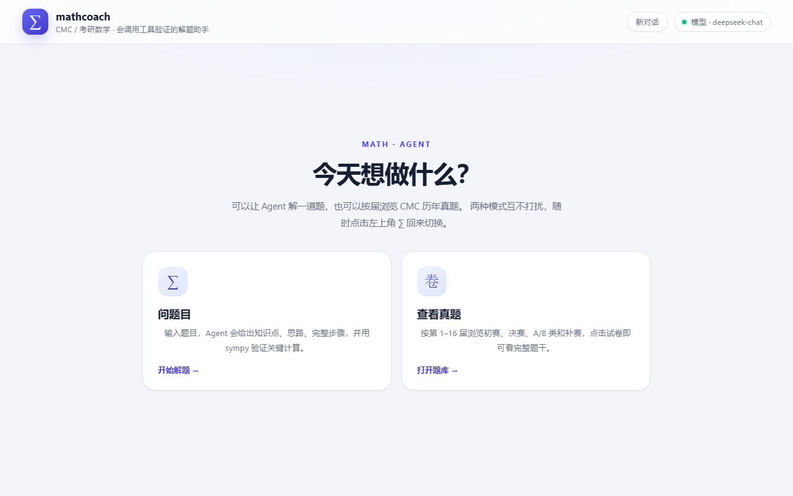
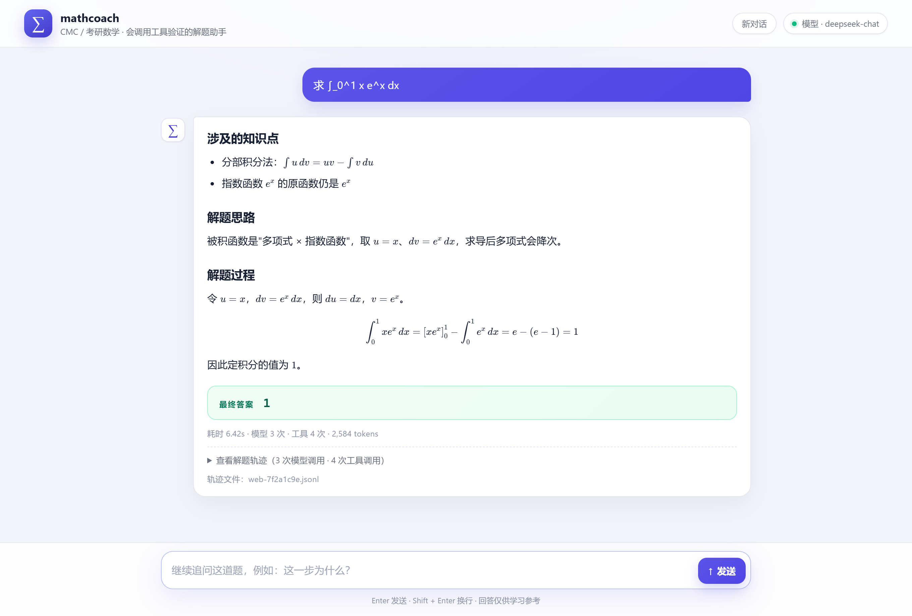
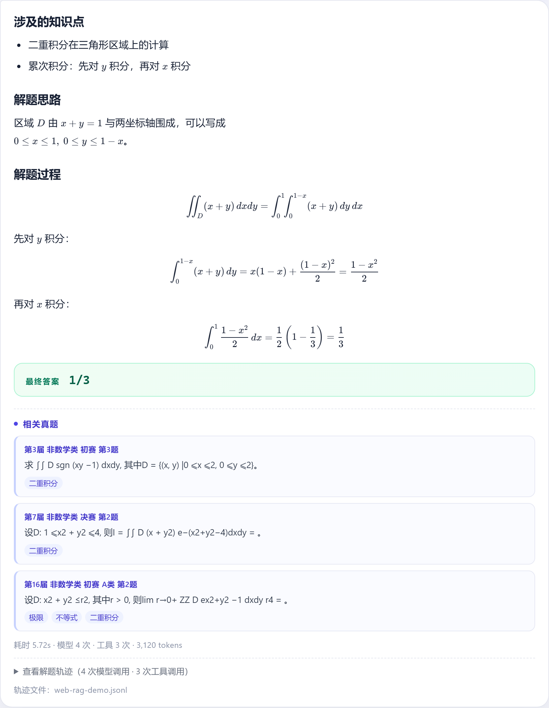

# mathcoach

面向 CMC（中国大学生数学竞赛）/ 考研数学的解题 Agent。

目标不是"把题目转发给大模型"：模型负责讲解和推导，关键计算交给 sympy
工具验证；题干信息不全时明确要求补充；每次改动都用固定评测集跑分对比，
让"变好了还是变差了"有数据可依。

## 项目规格

- 输入：文字题目（自然语言或 LaTeX）
- 输出：
  1. 涉及的知识点
  2. 解题思路
  3. 分步解题过程
  4. 最后一行固定为 `最终答案：<答案>`
- 工具：sympy（求导 / 积分 / 极限 / 化简 / 解方程）；CMC 非数学类历年真题检索
- 真题推荐：回答后附“相关真题”卡片（出处 + 题干 + 知识点），检索结果不作为
  本题的条件
- 拒答：题干信息不全，或题目本身是未解决猜想时，说明原因并请用户补充，
  不引入假设硬答
- 成功标准：24 道评测题（20 道求解 + 4 道应拒答），总通过率 ≥ 70%
- 暂不实现：拍照识题、向量检索与 rerank

## 快速开始

```bash
cd mathcoach
python -m venv .venv
.venv\Scripts\activate
pip install -r requirements.txt

# 配置模型：.env 已被 .gitignore 忽略，不要提交
copy .env.example .env
# 填入 OPENAI_API_KEY / OPENAI_BASE_URL / OPENAI_MODEL

python ask.py "计算 lim(x→0) sin x / x"   # 真实模型一问一答
python ask.py                              # 连续提问模式，exit 退出
python ask.py --stub "1+1"                 # 离线假模型，不联网
python -m web.app                          # 本地 Web 版，打开 http://127.0.0.1:8000
python -m rag.build                        # 从本地真题 PDF 构建题库（需要先有 PDF）
python -m rag.search "二重积分" --top 5     # 命令行检索真题
python agent.py                     # StubClient 离线演示，不联网
python -m eval.run_eval --stub      # 离线跑通评测流程
python -m eval.run_eval --real      # 真实模型跑评测并输出通过率
python -m eval.trace_report traces/eval-xxxx.jsonl   # 查看耗时 / token / 工具调用
pytest                              # 175 个测试
```

`eval.run_eval` 的常用开关：

| 开关 | 作用 |
| --- | --- |
| `--real` / `--stub` | 真实模型 / 离线假模型（默认 stub） |
| `--limit N` | 只跑前 N 题，用于冒烟测试 |
| `--trace-dir DIR` | 轨迹输出目录，默认 `traces/` |
| `--no-trace` | 不写轨迹文件 |

## Web 版（本地）

```bash
python -m web.app
# 浏览器打开 http://127.0.0.1:8000
```

只监听 `127.0.0.1`，不需要登录；API Key 留在服务端 `.env`，浏览器拿不到。
同一时间最多处理 2 道题，超过会直接返回 429，避免本地演示时并发消耗额度。

页面能力：

- Markdown + KaTeX 渲染公式，`\(...\)` / `\[...\]` 会自动转成美元符号分隔符
- 回答末尾单独提取"最终答案"卡片，正文里重复的那行标记会被去掉
- 同一页面内支持追问：服务端保存"第一轮原题 + 最近 3 轮"，自动做上下文裁剪；
  追问时不会强制重复完整解题格式
- 顶栏"新对话"会清空当前会话和页面消息
- 回答下方展示“相关真题”卡片（出处 + 题干 + 知识点），题库缺失时自动隐藏
- 显示耗时、轮次、模型调用次数、工具调用次数、token 用量
- 可展开的解题轨迹：每一步模型调用的耗时，以及每次工具调用的参数和结果
- 每次提问写一条 `traces/web-*.jsonl`，和评测轨迹使用同一套格式








后端接口：

- `POST /api/ask`：请求体 `{question, session_id?}`；首次提问不传 `session_id`，
  响应会返回服务端生成的 id，后续追问带同一个 id
- `DELETE /api/session/{session_id}`：结束会话，"新对话"按钮会调用

解题逻辑全部复用 `agent.Agent`，Web 层只做 HTTP 包装、会话管理和展示字段整理。
会话只存在进程内存里，服务重启后旧 id 自动失效并开始新会话；页面刷新也会开始
新对话（前端不持久化 session_id）。

## 真题库 RAG（本地）

题库来自本机的 CMC 非数学类历年真题 PDF，默认读取
`~/Desktop/数学竞赛分享`：

```bash
python -m rag.build
# 抽取题目：428 道 -> 去重后 417 道（初赛 240 / 决赛 177）
# 知识点覆盖 359/417（86%）

python -m rag.search "计算二重积分，其中D由x+y=1与两坐标轴围成" --top 3
python -m rag.search "求幂级数的收敛域" --stage 初赛 --json
```

也可以指定目录和输出：

```bash
python -m rag.build --papers-dir "D:/papers" --out data/processed/problems.jsonl
# 环境变量：CMC_PAPERS_DIR 控制 PDF 目录，CMC_INDEX_PATH 控制 JSONL 位置
```

处理链路：

```text
34 份试卷 PDF
   │ PyMuPDF 抽文本
   ▼
按版式切题（“题目N” / 2024-2025 的填空-选择-解答）
   │
   ▼
归一化：PDF 符号伪影（Z→∫、X→∑）、Unicode 数学符号、LaTeX 命令
   │
   ▼
中文二元组分词 + 25 个受控知识点标签
   │
   ▼
data/processed/problems.jsonl（题干 / 出处 / 届数 / 类别 / 知识点）
   │
用户提问 ── BM25 打分 ×（1 + 0.25 × 知识点重合度）
   │
   ├─ Agent 工具 search_past_problems(query, k) → 题干 + 出处 + 知识点
   └─ Web 返回 related_problems → 前端“相关真题”卡片
```

设计取舍：

- 题库没构建时，Web 端不开放检索工具，避免每轮都拿到“题库不存在”的工具错误。
- 工具只返回题干、出处、知识点，不返回解答：工具结果会进模型上下文，需要控制
  体积；完整解答留给后续的 `get_problem_detail`。
- 提示词明确要求检索结果是“其他题目”，禁止把其中的数字和结论搬进本题解答；
  正文最多用一句话点出最相关的一道，不重复题干（前端已有卡片）。
- 检索是 BM25 + 标签加权，没有向量和 rerank。中文按二元组切分，不依赖词典，
  对数学术语和少量抽取噪声更稳；代价是同义词（如“极值”与“最值”）匹配不到。
- 追问（“这一步为什么”）不强制检索，也不做检索补位，避免拿追问去搜题库。

数据说明：

- 真题 PDF 有版权风险，`data/` 已加入 `.gitignore`；仓库里只有代码，不提交题库。
- 2024/2025 两份试卷使用 Symbol 字体，抽出的公式会散架（如 `ZZ` 代表二重积分号），
  题干适合检索但可读性一般；展示前需要模型重建 LaTeX。
- 2018 年以前的试卷不分 A/B 类，统一标为“未分类”；检索 A 类时会把它们一并算入。
- 2024/2025 两份试卷按卷面结构切分，其余按“题目N”切分。

## 评测结果

评测集 24 题：20 道求解（symbolic / numeric / exact 三种判分方式）+ 4 道
应拒答。求解题先提取 `最终答案：` 行，再做符号等价 / 数值容差 / 精确匹配；
拒答题检查回答是否明确表示无法作答。

| 版本 | 主要改动 | solve | refuse | 总计 |
| --- | --- | --- | --- | --- |
| v1 | 初始提示词，整段回答直接判分 | 17/20 | 3/4 | 20/24（83.3%） |
| v2 | 最终答案契约 + 提取器 + LaTeX/Unicode 归一化 | 19/20 | 3/4 | 22/24（91.7%） |
| v3 | 修复 `2x\sin x` 的函数边界；扩充拒答标志 | 20/20 | 3/4 | 23/24（95.8%） |
| v4 | 补充"无法证明 / 未解决"类拒答标志 | 19/20 | 4/4 | 23/24（95.8%） |
| v5 | 修复 `\operatorname{...}` 的答案提取 | 20/20 | 4/4 | **24/24（100%）** |

v4 的 1 道 solve 记为 UNCERTAIN，原因是提取器不认识
`\operatorname{Var}(X)=1/12`；修复后回放同一份模型回答判为 PASS，v5 是
修复后的完整真实运行。

v5 轨迹指标：

- 耗时：总计 97.99 秒，平均 4.08 秒/题，p95 9.17 秒
- token：50,237（输入 37,646 / 输出 12,591），平均 2,093/题
- 调用：模型 53 次，工具 48 次，工具错误 0 次（0.0%）
- 护栏触发：0 次（无超时、无超步数、无模型异常）

> 注意：24 道题、单次运行的样本量都很小，100% 不代表模型已经稳定可靠。
> 后续扩题、多次运行取均值后，这组数字才适合做更严格的结论。

## 工作原理

```text
用户题目
   │
   ▼
Agent 循环（最多 10 步，单步 30 秒超时）
   ├─ 调用模型
   ├─ 模型请求工具 → run_tool → 结果回填 → 回到"调用模型"
   └─ 模型不再请求工具 → 返回最终回答
   │
   ▼
最终回答（知识点 / 思路 / 步骤 / 最终答案）
```

评测链路：

```text
cases.jsonl
   │
   ▼
Agent（注入 TraceRecorder）
   ├─ 正常回答 → extract_final_answer → judge_answer → PASS/FAIL/UNCERTAIN
   └─ 应拒答   → is_refusal → 正确拒答/未拒答
   │
   ├─ traces/*.jsonl（逐题事件、token、耗时、工具调用）
   └─ 控制台报告 + trace_report 汇总
```

## 目录结构

```text
mathcoach/
├── ask.py              # 命令行一问一答入口（最小产品壳）
├── agent.py            # Agent 循环、超时/步数护栏、轨迹事件
├── llm.py              # OpenAI 兼容客户端 + StubClient（同一接口）
├── tools.py            # sympy 验证 + 真题检索工具、注册表、run_tool 分派
├── mathparse.py        # LaTeX / Unicode / 省略乘号的统一归一化
├── tracing.py          # TraceRecorder：逐题写 JSONL
├── schemas.py          # Verdict 等数据结构
├── config.py           # 读取 .env
├── rag/
│   ├── build.py        # PDF -> JSONL 构建入口
│   ├── papers.py       # 试卷版式解析、去重
│   ├── textnorm.py     # 检索归一化、二元分词、知识点标签
│   ├── bm25.py         # 纯 Python Okapi BM25
│   ├── index.py        # 索引加载与 BM25 + 标签混合打分
│   └── search.py       # 命令行检索
├── data/               # 题库产物 problems.jsonl（已 gitignore）
├── web/
│   ├── app.py          # FastAPI 后端：静态页 + /api/ask + /api/health
│   ├── sessions.py     # 内存会话、TTL、上下文裁剪
│   ├── test_app.py
│   ├── test_sessions.py
│   └── static/         # 单页前端；KaTeX / markdown-it / DOMPurify 本地化
├── eval/
│   ├── cases.jsonl     # 24 道评测题
│   ├── judge.py        # symbolic / numeric / exact 判定
│   ├── extract.py      # 从回答里提取"最终答案："
│   ├── run_eval.py     # 跑批、自检、报告
│   └── trace_report.py # 轨迹汇总
├── test_agent.py
├── test_ask.py
├── test_rag.py
├── test_tools.py
└── traces/             # 评测与问答轨迹（已 gitignore）
```

## 已知限制

- 只支持文字输入；拍照 / 相册识题尚未实现。
- `sympy.parse_expr` 最终会执行字符串表达式。目前只处理本地评测集和模型
  输出；接入真实用户输入前，需要换成受限命名空间或独立的沙箱解析。
- 拒答识别仍是关键词匹配，措辞变化可能误判。后续计划换成 LLM-as-judge，
  并用混淆矩阵评估。
- 评测集只有 24 题，且每版只跑一次，无法反映模型波动。
- Web 版没有登录、限流和公网部署方案，只适合本机演示。
- 多轮会话只存在服务端内存：服务重启丢失；刷新页面会开始新对话；没有跨会话的
  长期记忆。
- 检索目前只有 BM25 + 知识点加权：同义表述（“极值”/“最值”）和纯符号题召回
  有限；还没有向量召回、rerank 和检索评测集。
- 2024/2025 真题的公式抽取质量差，只适合检索，不适合直接展示。
- 无流式输出。

## 下一步

1. 扩充评测集，覆盖证明题、选择题和更多拒答措辞；引入多次运行与方差统计。
2. 建检索评测集（人工标注 50 条查询），对比 BM25、标签加权、向量召回、
   rerank 的 Recall@5 与 MRR，把消融结果写进 README。
3. 在现有检索上加 `bge-small-zh-v1.5` 向量召回，用 RRF 与 BM25 融合；
   视效果决定是否加 cross-encoder rerank。
4. Planner → Solver → Verifier 多 Agent 协作，与当前单 Agent 做消融对比。
5. 完善 Web 版：流式输出、图片输入，以及带登录和限流后的公网部署。
