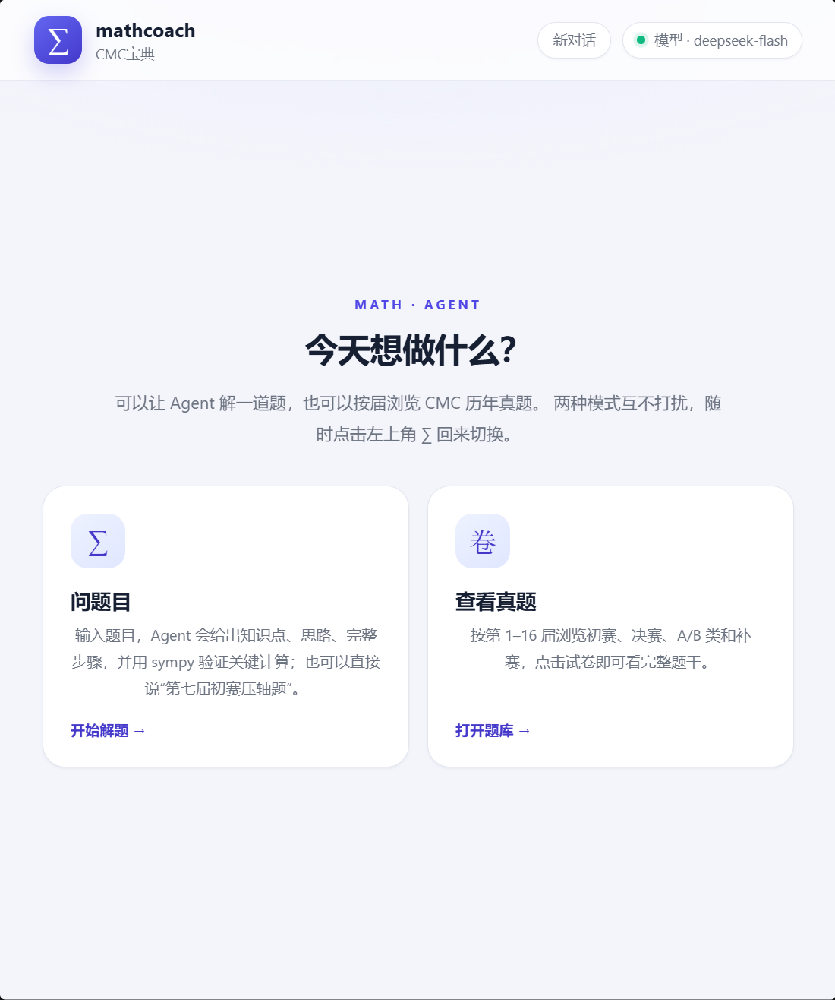
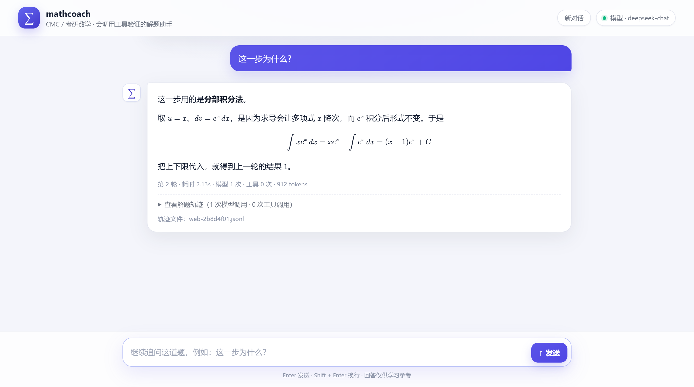

# mathcoach

面向 CMC（中国大学生数学竞赛）/ 考研数学的解题 Agent。

目标不是"把题目转发给大模型"：模型负责讲解和推导，关键计算交给 sympy
工具验证；题干信息不全时明确要求补充；每次改动都用固定评测集跑分对比，
让"变好了还是变差了"有数据可依。



## 项目规格

- 输入：文字题目（自然语言或 LaTeX）；Web 版可选上传/粘贴题目截图，
  默认经 DeepSeek 视觉模型（`deepseek-flash`）整页识别成可编辑文本后再解题；
  也支持本地 Ollama / SimpleTex 作为备选
- 输出：
  - 快速模式：最终答案 + 必要关键步骤 + 工具验证状态，最后一行固定为
    `最终答案：<答案>`
  - 详细模式：涉及的知识点、解题思路、分步解题过程、最后统一答案；
    由 Planner → Solver → Verifier 生成并复核
- 工具：sympy（求导 / 积分 / 极限 / 化简 / 解方程）；CMC 非数学类历年真题检索
- 真题推荐：回答后附“相关真题”卡片（出处 + 题干 + 知识点），检索结果不作为
  本题的条件；检索用 BM25 + BGE 向量 + RRF
- 拒答：题干信息不全，或题目本身是未解决猜想时，说明原因并请用户补充，
  不引入假设硬答
- 成功标准：2024、2025 两年 CMC 真题共 34 题（每年 6 填空 + 6 选择 +
  5 解答），总通过率 ≥ 70%
- 暂不实现：cross-encoder rerank、手写公式的专项识别优化

## 快速开始

仓库自带：

- `kb/`：399 道题 + 212 道官方答案 + 展示用 LaTeX + BGE 文档向量
- `models/bge-small-zh-v1.5`：BGE 模型（Git LFS 管理，约 92 MB）

用户只需要准备 **Python 3.10+** 和 **自己的 DeepSeek API Key**。

### Windows

- 安装 Python 3.10+，勾选 “Add Python to PATH”
- 安装 Git LFS（首次使用）
- clone 仓库：

  ```bash
  git lfs install
  git clone <仓库地址>
  cd mathcoach
  ```

- 双击 `start.bat`
- 在自动打开的记事本里填写：

  ```bash
  OPENAI_API_KEY=你的 DeepSeek Key
  ```

- 保存并关闭记事本，脚本会自动启动服务并打开：

  ```text
  http://127.0.0.1:8000
  ```

### macOS / Linux

```bash
git lfs install
git clone <仓库地址>
cd mathcoach
chmod +x start.sh
./start.sh
```

首次运行会创建 `.env`，填写 `OPENAI_API_KEY` 后重新运行即可。

### 手动启动

```bash
cd mathcoach
python -m venv .venv
.venv\Scripts\activate        # macOS/Linux: source .venv/bin/activate
pip install -r requirements.txt
copy .env.example .env        # macOS/Linux: cp .env.example .env
# 只需填写 OPENAI_API_KEY；kb/ 和 models/ 路径已经在 .env.example 里配好
python -m web.app
```

不需要安装 Ollama，也不需要自己的服务器。

### 开发者命令

```bash
python ask.py "计算 lim(x→0) sin x / x"   # 真实模型一问一答
python ask.py                              # 连续提问模式，exit 退出
python ask.py --stub "1+1"                 # 离线假模型，不联网
python -m web.app                          # 本地 Web 版，打开 http://127.0.0.1:8000
python -m rag.search "二重积分" --top 5     # 命令行检索真题（默认混合检索）
python -m rag.search "二重积分" --retriever bm25   # 只跑 BM25，便于对照
python -m rag.evaluate --misses             # 检索评测：BM25 / BGE / RRF
python agent.py                     # StubClient 离线演示，不联网
python -m eval.run_eval --stub      # 离线跑通评测流程
python -m eval.run_eval --real      # 真实模型跑评测并输出通过率
python -m eval.run_eval --real --verify   # 再对失败的题做独立复核 + 重解
python -m eval.trace_report traces/eval-xxxx.jsonl   # 查看耗时 / token / 工具调用
python -m eval.ocr_eval --sections fill,choice,solve   # OCR 评测：真题裁成单题
python -m eval.ocr_eval --degrade phone               # 同一批题模拟手机拍照退化
pytest                              # 452 个测试
```

如果要重建知识库（仓库不包含 PDF）：

```bash
python -m rag.build --papers-dir papers    # 需要用户自备 PDF
python -m rag.build_embeddings
python -m rag.latex
```

`eval.run_eval` 的常用开关：

| 开关 | 作用 |
| --- | --- |
| `--real` / `--stub` | 真实模型 / 离线假模型（默认 stub） |
| `--verify` | 首轮未通过的题交给独立复核器；复核确认错误时反馈重解一次 |
| `--limit N` | 只跑前 N 题，用于冒烟测试 |
| `--trace-dir DIR` | 轨迹输出目录，默认 `traces/` |
| `--no-trace` | 不写轨迹文件 |

## Web 版（本地）

```bash
python -m web.app
# 浏览器打开 http://127.0.0.1:8000
```

只监听 `127.0.0.1`，不需要登录；API Key 留在服务端 `.env`，浏览器拿不到。
同一时间最多处理 2 道题，超过会直接返回 429，避免本地演示时并发消耗额度。

图片识题默认复用 DeepSeek 视觉模型（`deepseek-flash`），和解题共用一个
`OPENAI_API_KEY`，用户不需要安装 Ollama：

```bash
OPENAI_API_KEY=用户自己的 DeepSeek Key
OPENAI_BASE_URL=https://api.deepseek.com
OPENAI_MODEL=deepseek-flash
OPENAI_VISION_MODEL=deepseek-flash
OCR_PROVIDER=deepseek
```

图片会发送到 DeepSeek，并按 token 计费（官方文档按约 1024 tokens/张估算）。
如果不想用云端，也可以切到本机 Ollama 或 SimpleTex：

```bash
# 备选一：本机 Ollama，免费、图片不出本机
OCR_PROVIDER=ollama
# ollama pull glm-ocr && ollama serve

# 备选二：SimpleTex 数学 OCR
OCR_PROVIDER=simpletex
SIMPLETEX_TOKEN=用户自己的令牌
```

之后点击输入框左侧的图片按钮，或直接 `Ctrl+V` 粘贴截图即可。识别结果会生成一张
**排版后的题目卡**，不再把 LaTeX 源码塞进输入框：左侧是原图，右侧是渲染后的题干，
核对无误直接发送即可。公式认错时，点单个公式就能改；整段有问题时再打开“编辑源码”，
里面会列出每个公式和源码的对照，并附一份常用写法小抄。如果说不清源码，直接在题目卡
下方用大白话说“根号应该是三次根”之类的错误，点“AI 修正”会带着原题再校对一次，
只改题干，不会开始解题。输入框只用于填写补充说明，发送时会自动和题目卡拼接。
识别结果**不会自动提交**，整页图里的细小根号/上标更容易认错，时间也明显更长；
只问一道题时，先裁到题目范围再上传更稳。服务端不主动保存图片、不写 trace。

如果 `ocr_available=false`（没有配置 OCR Key，或本机 Ollama 未启动），页面会
禁用图片按钮并提示“文字提问仍可用”，不会等用户上传后才弹红色错误。

页面能力：

- 首页居中提供「问题目 / 查看真题」两种模式，互不干扰；点击左上角 ∑ 随时回到模式选择
- 默认先返回「快速答案」：单 Agent + 工具验证，不检索真题，适合填空、
  选择和简单计算；答案下方显示“已工具验证 / 未独立复核”。快速模式走
  SSE 流式输出，模型生成到哪就显示到哪，不必等整段回答结束
- 快速答案下方提供「查看详细过程」：点击后运行 Planner → Solver →
  Verifier 多 Agent，页面实时显示当前阶段（规划 / 解题 / 复核 / 重解）、
  复核结论和耗时，详细结果追加在快速答案下方。Solver 的正文也是流式
  推送的：阶段条下方会实时显示正在书写的解答，点停止会立即中断
- 检测到“证明 / 求证 / 试证”时自动走详细过程，避免给出未复核的证明
- 步骤级追问使用每步下方的“问这一步”；多 Agent 的 token 和延迟会比
  快速模式高
- 解题模式：Markdown + KaTeX 渲染公式，`\(...\)` / `\[...\]` 会自动转成美元符号分隔符
- 解题模式：回答末尾单独提取"最终答案"卡片，正文里重复的那行标记会被去掉
- 求解等待期间显示「停止」按钮：浏览器立即恢复输入，同时通知服务端在
  下一次模型/工具调用前停止；已发出的单次请求无法中断，但不会再继续后续步骤。
  停止会立刻释放会话锁，可以马上重新提问；旧请求的迟到结果不会写回会话
- 同一页面内支持追问：服务端保存"第一轮原题 + 最近 3 轮"，自动做上下文裁剪；
  追问时不会强制重复完整解题格式
- 会话默认落到 `data/sessions.db`：服务重启或刷新页面后会自动恢复最近一轮问答、
  最终答案卡和步骤结构，可以继续追问；点“新对话”会同时删除服务端会话和本地记录
- 完整解答按 `### 第一步：...` 切成步骤卡片；步骤标题里的 `$...$` 也会渲染成
  行内公式。点击「问这一步」打开右侧独立抽屉，只围绕当前步骤追问。
  侧栏使用单独会话，消息不会写进主对话，也不会改变主对话轮次；右上角
  「新对话」只清空当前步骤的追问记录并开启新一轮，步骤引用和主对话保持不变
- 顶栏"新对话"会清空当前会话和页面消息，并回到解题模式
- 回答下方展示“相关真题”卡片（出处 + 题干 + 知识点），题库缺失时自动隐藏；
  题干使用 `display_question` 的 LaTeX 重建结果，和助手回答走同一套 KaTeX 管线
- 官方答案/参考解答在返回前会补齐公式定界符：OCR 产生的裸 LaTeX
  （如 `\frac{1}{2}`）会自动包成 `$...$`，中文和中文标点留在公式外；
  已带 `$` 的内容不会重复包裹
- 真题模式：左侧列出第 1–17 届的所有试卷（初赛 / 决赛 / A、B 类 / 补赛），
  点击后右侧显示该卷全部题干；原始题干直接来自题库，展示时优先使用构建阶段
  缓存的 `display_question`，不额外调用模型。每道题下有“显示答案”按钮，
  展开后可看官方答案与参考解答（未收录的题会明确提示）
- 图片识题：上传或 `Ctrl+V` 粘贴截图（DeepSeek 视觉和本地 GLM-OCR 支持
  PNG / JPG；云端 SimpleTex 额外支持 BMP），识别后生成“原图 + 排版题目”的题目卡。
  公式默认按 KaTeX 渲染，不向普通用户暴露整段 LaTeX：点击单个公式会打开
  带实时预览和符号按钮的编辑器；高级用户可以切到“编辑源码”，先看
  “公式 ↔ 源码”对照表再整段修改。题目卡下方还有大白话纠错框：用户直接说
  哪里识别错了，前端调用 `/api/ocr/fix` 让模型做一轮题干校对并重新排版。
  输入框只写补充说明，发送时自动拼接。识别/校对中禁止发送，状态条右侧可取消；
  整页图会提示先裁到单题。识别中/成功/失败都有状态提示
- 用户发出的消息也走 Markdown + KaTeX 渲染，聊天记录里不会出现 `$...$` 源码
- 显示耗时、轮次、模型调用次数、工具调用次数、token 用量
- 可展开的解题轨迹：每一步模型调用的耗时，以及每次工具调用的参数和结果
- 每次提问写一条 `traces/web-*.jsonl`，和评测轨迹使用同一套格式





后端接口：

- `POST /api/ask`：请求体 `{question, session_id?, request_id?, mode?}`；
  `mode="fast"` 走单 Agent、不检索、关闭 reasoning，优先低延迟；
  默认 `standard` 保留完整讲解。首次提问不传 `session_id`，后续追问带同一个 id。
  如果模型调用了 `list_past_problems`，响应会额外带上完整试卷 `paper`；
  完整解答还会返回 `turn_id` 和 `solution`（`intro` / `steps` / `outro`）
- `POST /api/ask-stream`：与 `/api/ask` 参数相同，返回 `text/event-stream`。
  正文按段推送 `{type:"delta", text}`，结束时推送一个带完整
  `AskResponse` 字段的 `{type:"done"}`；快速模式前端使用这个接口。
  客户端不支持流式时会自动退回普通调用，不影响结果
- `POST /api/ask-multi`：请求体 `{question, session_id?, request_id?}`，
  返回 `text/event-stream`。依次推送 `stage` 事件（planner / solver /
  verifier / revision）、Solver 正文的 `delta` 事件和最后的 `final` 事件；
  点停止会通过 `/api/ask/cancel` 中断当前阶段。最终回答会写入会话并返回
  `turn_id` / `solution`，因此回答下方的“问这一步”仍可用
- `POST /api/ask-step`：针对某一轮回答中的某一步追问。请求体为
  `{question, parent_session_id, parent_turn_id?, parent_turn?, step_index,
  step_text?, step_session_id?}`；响应只包含这一步的短回答和独立的
  `step_session_id`，不会修改主会话
- `POST /api/ocr`：`multipart/form-data`，字段名 `file`。只做识别，不调用解题
  模型、不创建会话；返回 `{text, mode, confidence?}`，前端生成题目卡后由用户
  核对、修改并手动发送。DeepSeek / SimpleTex 未配置或 `OCR_PROVIDER` 无效
  返回 503，格式/大小/上游失败分别返回 415 / 413 / 502
- `POST /api/ocr/fix`：请求体 `{text, instruction}`，带着原识别结果和用户的大白话
  纠错说明做一轮题干校对；返回 `{text, elapsed, truncated}`，不创建会话、不触发
  解题。未配置 API Key 返回 503，模型正忙返回 429，上游失败返回 502
- `GET /api/session/{session_id}`：恢复一个仍存在的会话；返回每轮的题干、回答、
  最终答案和步骤结构，供刷新页面后重建聊天记录。已过期或已删除返回 404
- `DELETE /api/session/{session_id}`：结束会话，"新对话"按钮会调用
- `GET /api/papers`：第 1–17 届的试卷目录（每份卷子的阶段、类别、补赛、题数）
- `GET /api/paper?edition=16&stage=决赛&category=B&supplement=&section=`：
  读取一份试卷的完整题干；`edition` 与 `year` 二选一，
  `supplement` 省略表示不限补赛、传空串表示只要正卷。`question` 是题库原文，
  `display_question` 是重建后的 Markdown + LaTeX（没有缓存时为空串）；
  `answer` / `solution` 是官方答案与参考解答，未收录时为空串
- `GET /api/health`：除模型状态外，还返回 `retriever`（auto/bm25/vector/hybrid）、
  `vector_available`、`embedding_model`、`sessions` / `step_sessions` 会话计数和
  `session_persistent`，方便确认混合检索与持久化是否真的启用

解题逻辑全部复用 `agent.Agent`，Web 层只做 HTTP 包装、会话管理和展示字段整理。
会话默认写入本地 SQLite `data/sessions.db`（只存最终问答，不存工具轨迹），
同时带 TTL 和容量上限。浏览器把 `session_id` 放在 `localStorage`，刷新页面会
自动恢复；点“新对话”或超过 TTL 后才丢弃。设置 `CMC_SESSION_DB=off` 可退回
纯内存模式。

## 真题库 RAG（本地）

应用题库使用第 1–16 届的初赛/决赛试卷（32 份 PDF，放在 `papers/` 目录），
再加上第 17 届（2025）初赛 A/B 类的题目与官方参考解答。2024/2025 两套
近年卷仍只用于评测，不进入应用题库。

```bash
python -m rag.build --papers-dir papers
# 抽取题目：394 道 -> 去重后 383 道（初赛 206 / 决赛 177）
# 再加上第 17 届 16 道去重题，应用题库共 399 道（初赛 222 / 决赛 177）
# 知识点覆盖 343/399（86%）

python -m rag.build_embeddings
# 399 道 × 512 维，写入 data/processed/embeddings.npz

python -m rag.latex
# 用模型把题干重建为 Markdown + LaTeX，写入 data/processed/question_latex.json
# 中途失败可重跑：按题目 id + 内容哈希跳过已完成项

python -m rag.search "计算二重积分，其中D由x+y=1与两坐标轴围成" --top 3
python -m rag.search "求幂级数的收敛域" --stage 初赛 --json
python -m rag.search "圆环区域上带指数衰减因子的二重积分" --retriever hybrid
```

也可以指定目录和输出：

```bash
python -m rag.build --papers-dir "D:/papers" --out data/processed/problems.jsonl
# 环境变量：CMC_PAPERS_DIR 控制 PDF 目录，CMC_INDEX_PATH 控制 JSONL 位置
```

处理链路：

```text
32 份初赛/决赛试卷 PDF + 第 17 届初赛 A/B 整理稿
   │ PyMuPDF 抽文本 / 人工校对后的 Markdown
   ▼
按版式切题（“题目N” / 2024-2025 的填空-选择-解答）
   │
   ▼
归一化：PDF 符号伪影（Z→∫、X→∑）、Unicode 数学符号、LaTeX 命令
   │
   ▼
中文二元组分词 + 25 个受控知识点标签
   │
   ▼
data/processed/problems.jsonl
（question / question_layout / 出处 / 届数 / 类别 / 知识点）
   ├─ BM25 索引（中文二元组 + 知识点加权）
   ├─ BGE 编码 → data/processed/embeddings.npz（399 × 512）
   └─ python -m rag.latex → question_latex.json（display_question）
          │
用户提问 ─┼─ BM25 Top-20 ─┐
          └─ BGE Top-20 ──┴─ RRF 融合 → Top-K
   │
   ├─ Agent 工具 search_past_problems(query, k) → 相似题题干 + 出处 + 知识点
   ├─ Agent 工具 get_past_problem(届数/年份 + 题号/位置) → 指定题的完整题干
   └─ Web 返回 related_problems / paper → 前端用 KaTeX 渲染 display_question
```

设计取舍：

- 题库没构建时，Web 端不开放检索工具，避免每轮都拿到“题库不存在”的工具错误。
- 检索工具只返回题干、出处、知识点，不返回解答：工具结果会进模型上下文，需要
  控制体积；完整解答由 Agent 自己生成。
- 提示词明确要求检索结果是“其他题目”，禁止把其中的数字和结论搬进本题解答；
  正文最多用一句话点出最相关的一道，不重复题干（前端已有卡片）。
- “第七届初赛压轴题”这类输入不是题干，不能走相似度检索。`get_past_problem` 用
  届数/年份、阶段、类别、题型和题号做确定定位，返回完整 `question`（优先展示用
  LaTeX）；“压轴题/最后一题”由 `position="last"` 解析成该组最大题号。同届有多份
  符合条件的试卷时返回 `candidates`，让模型先向用户确认初赛/决赛，不替用户猜。
- 检索默认是 BM25 + BGE 向量 + RRF：BM25 负责公式和术语的精确词面命中，
  BGE 负责同义表述和语义查询，RRF 只看名次、不看两路分数的量纲。中文仍按
  二元组切分，不依赖词典；向量模型是 `BAAI/bge-small-zh-v1.5`（512 维，CPU）。
- 向量缓存与题库、模型绑定：题号或模型变化后，工具层检测到不一致会自动回退
  BM25，不会拿旧向量硬搜新题库。
- 展示用 LaTeX 在构建阶段生成一次并缓存，运行时零模型调用。PDF 的文字层把
  分数压成上下两行、把上下标压成普通字符，仅靠正则无法还原；但 `question_layout`
  保留了换行和字号（正文 12pt、上下标/分子分母 8pt），模型可以据此重建结构。
  缓存按“题目 id + 题干 + layout + 提示词版本”的哈希校验，内容变化后自动失效；
  缓存缺失或某题生成失败时，前端回退到原始纯文本，不会白屏或显示半截公式。
- 追问（“这一步为什么”）不强制检索，也不做检索补位，避免拿追问去搜题库。

### BGE 向量与 RRF 混合检索

BM25 对公式、符号和术语很强，但用户只给语义描述时会漏召回。向量检索补这一块，
两路结果再用 RRF 合并：

```text
查询 ── BM25 Top-20 ─────────────┐
  │                              ├─ RRF：Σ weight / (60 + rank) ── Top-K
  └─ BGE 编码 → 余弦 Top-20 ─────┘
```

实现位置：

- `rag/vector.py`：BGE 懒加载、文档/查询编码、L2 归一化、余弦 Top-K、
  `.npz` 缓存和“题库/模型是否变化”的校验；
- `rag/hybrid.py`：RRF 融合、纯向量检索、BM25+向量混合检索；
- `rag/build_embeddings.py`：为整库生成向量缓存；
- `tools.search_past_problems`：按 `CMC_RETRIEVER` 选择 `auto`（默认）/
  `bm25` / `vector` / `hybrid`；模型缺失、依赖未安装、缓存过期时自动回退 BM25。
- `tools.get_past_problem`：按届数/年份、阶段、类别、补赛、题型和题号做确定
  定位；`position=last/first` 解析压轴题/第一题，返回完整题干（优先
  `question_latex.json` 的展示版）。

仓库自带配置（`.env.example`，用户复制为 `.env` 后只需填 Key）：

```bash
CMC_INDEX_PATH=kb/problems.jsonl
CMC_ANSWERS_PATH=kb/answers.jsonl
CMC_EMBEDDINGS_PATH=kb/embeddings.npz
CMC_LATEX_PATH=kb/question_latex.json
CMC_EMBEDDING_MODEL=models/bge-small-zh-v1.5
CMC_MODEL_CACHE=models
HF_HOME=models/hf-cache
CMC_RETRIEVER=auto
# 默认不加查询指令；设成官方指令可做消融
CMC_QUERY_PREFIX=
```

几个取舍：

- **编码文本 = 题干 + 知识点标签**。出处、届数不进编码文本，避免“第 16 届”
  这类元数据抢语义权重；知识点是题目的压缩摘要，能帮助短题干和公式题聚类。
  在 47 条评测查询上（同一组融合参数），加标签让 RRF 的 Recall@1
  从 76.6% 提到 83.0%。
- **查询侧默认不加 BGE 指令**。官方建议短查询加
  `为这个句子生成表示以用于检索相关文章：`，但在本项目的评测集上不加指令
  的召回更好；保留 `CMC_QUERY_PREFIX` 便于复现官方设置或做消融。
- **BM25 权重 1.5 : 向量 1.0**。数学题里公式和术语是强信号，词面精确命中的
  精度高；向量负责补同义表述。RRF 的 `k=60`，候选各取 20 条。
- **首次检索会加载模型**（本机 CPU 约 7 秒），之后同一进程内复用；
  向量缓存重新构建后需要重启 Web 进程，或者调用 `tools.clear_vector_cache()`。
- `sentence-transformers` 会安装 CPU 版 torch（数百 MB），模型文件约 100 MB；
  下载路径由 `CMC_MODEL_CACHE` / `HF_HOME` 控制，本项目放在 D 盘。

### 按届浏览完整真题

检索解决“找相似题”，按届浏览解决“把某一年的卷子完整拿出来”，两者走不同路径：

```text
查看真题页 ── GET /api/papers ── paper_index()：第 1-17 届目录
     │
     └─ 点击试卷 ── GET /api/paper?edition=…&stage=… ── list_problems()
                                                    │
                                                    └─ group_problems()
                                                       按阶段 / 类别 / 补赛 / 题型分组，
                                                       并计算缺号
```

实现要点：

- **原始题干不经过模型**：`question` 直接从 `problems.jsonl` 读取，避免模型漏抄、
  改写，也避免把整卷塞进上下文。展示用的 `display_question` 来自构建阶段预生成
  的缓存，读取接口本身不调用模型。
- **去重别名展开**：建库时同一道题可能跨届重复，去重后只保留一条主记录，旧 id
  放进 `aliases`。按届浏览时会把 `[id, *aliases]` 逐个解析回原试卷位置，否则
  会出现“第 13 届决赛缺第 9 题”的假象。现在第 1–17 届的题号都是连续的。
  第 17 届 A/B 卷有四道重复题（平面、隐函数、微分方程、级数），也通过
  `aliases` 同时出现在两套卷子里。
- **每题可展开官方答案**：试卷接口除题干外还返回 `answer` / `solution`；
  前端在每道题下渲染“显示答案”按钮，展开后用同一套 Markdown + KaTeX 管线
  显示答案和参考解答。官方答案来自《第 1–17 届…预赛试题参考解析汇总》的
  本地 OCR 导入：初赛 222 个题位中已覆盖 212 个，第 1–12、14–17 届全部覆盖；
  第 13 届补赛 10 题因为源 PDF 没有收录，仍显示“暂无官方答案”。决赛 177 题
  没有官方解答来源，同样保持“暂无”。答案只用于“查看真题”页面，不进入
  解题 Agent 的检索上下文，也不会被冒充成模型生成的解答。
- **Agent 也能列卷**：聊天里说“我要第一届真题”时，模型调用 `list_past_problems`；
  工具只返回题号、出处和数量，Web 层再按同一组参数重新读题库补全题干。
- **Agent 也能定位单题并解答**：聊天里说“第七届非数学 A 类初赛压轴题”时，模型
  调用 `get_past_problem(edition=7, stage="初赛", category="A", position="last")`，
  取回第 10 题的完整题干后直接作答，不需要用户重新粘贴。
- **区分语义检索和元数据过滤**：届数、阶段、类别都是确定字段，过滤即可 100%
  命中；向量检索只解决“题目意思相近”，不能替代按届浏览或定位单题。

当前应用题库：399 道题，第 1 届 23 道、第 13 届 30 道、第 15 届 27 道、
第 16 届 36 道、第 17 届 16 道（A/B 各 10 个题位，四道重复题合并）；
所有试卷分组均为题号连续。第 1–17 届共 17 个届次，不含只用于评测的
2024/2025 两套近年卷。

数据说明：

- 仓库自带 `kb/` 下的四个文件：`problems.jsonl`、`embeddings.npz`、
  `question_latex.json`、`answers.jsonl`；`CMC_*_PATH` 可以覆盖默认路径。
  用户 clone 后不需要 PDF，也不需要重新建库。
- 官方答案按题目 id 合并进索引；答案文件缺失时试卷页自动回到
  “暂无官方答案”，补答案不需要重建题库或向量缓存。
- 答案文本来自本地 GLM-OCR 对扫描件的逐页识别，再用“规则切题 + 模型摘录
  最终答案”整理；OCR 对细小根号、上下标仍可能出错，抽查时以原 PDF 为准。
  `data/private/` 里的 OCR 中间产物和原始 PDF 仍不进入 Git。
- 32 份初赛/决赛 PDF 和生成的 `problems.jsonl` / 向量缓存不进入 Git 历史，
  由 Release 数据包分发；仓库本身只保留代码、安装/构建脚本和第 17 届的
  整理稿 `rag/seventeenth.py`。
- 2024/2025 两套近年卷只保留在评测目录，用于 34 题官方真题评测，不进入应用题库。
- 2024/2025 两份试卷使用 Symbol 字体，抽出的公式会散架（如 `ZZ` 代表二重积分号），
  题干适合检索但可读性一般；展示时读取 `question_latex.json` 的重建结果。
- 重建缓存不是题库的一部分：修改题干或提示词后，重跑 `python -m rag.latex`
  会按哈希自动补齐失效项；只想抽查时加 `--limit 20`。
- 2018 年以前的试卷不分 A/B 类，统一标为“未分类”；检索 A 类时会把它们一并算入。
- 2024/2025 两份试卷按卷面结构切分，其余按“题目N”切分。

### 检索评测

固定查询集 `rag/eval_queries.jsonl`，共 47 条人工标注查询：

- `easy` 37 条：原题改写、公式查询、知识点关键词；
- `hard` 10 条：只给语义描述，尽量避开题干原词（例如“圆环区域上带指数衰减因子的二重积分”）。

```bash
python -m rag.evaluate            # 对比 BM25 / 标签加权 / BGE / RRF
python -m rag.evaluate --misses   # 列出未命中的查询
python -m rag.evaluate --no-vector  # 只跑 BM25 两组，不加载模型
```

当前基线（k=5）：

| 方案 | Recall@1 | Recall@5 | MRR |
| --- | --- | --- | --- |
| BM25（不加权） | 74.5% | 97.9% | 0.835 |
| BM25 + 标签加权 | 74.5% | 97.9% | 0.835 |
| BGE 向量 | 68.1% | 91.5% | 0.763 |
| **BM25×1.5 + BGE×1 + RRF** | **83.0%** | **97.9%** | **0.885** |

分难度（RRF）：

| 难度 | 条数 | Recall@1 | Recall@5 | MRR |
| --- | --- | --- | --- | --- |
| easy | 37 | 83.8% | 100.0% | 0.899 |
| hard | 10 | 80.0% | 90.0% | 0.833 |

四个结论：

- **RRF 明显改善排序质量**：Recall@1 74.5% → 83.0%，MRR 0.835 → 0.885，
  Recall@5 保持 97.9%。单看 BGE 反而更差（68.1%），说明它不是替代 BM25，
  而是提供另一种排序信号。
- **标签加权仍然无效**：Top-5 候选通常共享同一个知识点，乘性系数对所有候选
  相同，等于乘了一个常数。它目前只是保留作消融对照。
- **h01 仍未被 Top-5 召回**：`计算圆环区域上带指数衰减因子的二重积分`
  的正确答案在 BGE 里排第 1，但 BM25 的前几名也被 BGE 排进前 5，RRF 的
  “共识票”把它挤了下去。这是 RRF 的典型失败模式，下一步应尝试
  cross-encoder rerank 或 query-adaptive 融合，而不是继续手调权重。
- **BGE 的 4 条未命中集中在纯公式题**（q01–q03 的极限、q08 的二重积分）：
  符号和上下标在语义模型里信息量有限，这类查询更适合 BM25。

> 47 条查询仍是初版标注，而且上面的权重/指令设置是在同一组查询上比较后选的，
> 存在过拟合风险。应先复核并冻结标签，再用留出集确认收益；只看单个例子的
> “感觉更准了”不算数。

## 评测结果

评测集固定为 2024、2025 两年 CMC 非数学类真题，题目与标准答案均取自
`2024答案版.pdf` / `2025答案版.pdf`，填空和选择的题干取自对应试卷版。
每年 6 道填空 + 6 道选择 + 5 道解答，共 34 题。旧版 24 道自拟题的结果
已全部作废，不再作为准确率依据。

判分方式：

- 填空 / 选择：提取 `最终答案：` 行后做符号等价、数值容差、精确匹配或
  坐标点判定；
- 多小问解答：`parts` 按小问分别抽取、分别判分，全部正确才算该题通过；
- 证明题：`rubric` 按官方解答的关键步骤清单判分。它只能检查关键结论有没有
  写出来，不能替代人工阅卷，因此证明题的通过/失败要结合原始回答复核；
- `--verify`：首轮未通过的题交给独立复核器。非证明题只有复核器自己算出的
  答案命中官方答案才改判；证明题的复核 PASS 只标“复核放行”，仍需人工确认。

### 最近运行记录

| 运行 | 配置 | 首轮自动 | 复核后 | 2024 | 2025 |
| --- | --- | --- | --- | --- | --- |
| 第 7 次 | 工具三态 + 超时重试 + 独立复核 | 29/34（85.3%） | 33/34（97.1%） | 16/17 | 17/17 |
| 第 8 次 | 再修正复核器步数与选择题答案解析 | 30/34（88.2%） | 32/34（94.1%） | 17/17 | 15/17 |
| 第 9 次 | 修正 `parts` 中文标签 | 24/34（70.6%） | 33/34（97.1%） | 17/17 | 16/17 |
| 第 10 次 | 会话持久化 + 停止释放 + 解析安全加固（当前） | 26/34（76.5%） | 33/34（97.1%） | 16/17 | 17/17 |

第 7–9 次首轮 24–30/34（平均 27.7，81.4%），复核后 32–33/34（平均 32.7，96.1%）。
首轮的波动远大于复核后，说明“模型这次能不能一次做对”随机性很强：同一个失败的
sympy 调用可能连锁导致撞上 15 步上限。复核后的数字包含最多两次额外作答，代表
**Agent + 复核 + 重解的系统表现**，不是单次模型能力。

第 10 次的唯一失败题 2024-F5 单独重跑后通过（提取答案 `1/3`，29 秒），
说明它仍是首轮随机性导致的步数耗尽，而不是稳定回归。第 10 次仍沿用
“33/34（97.1%）”作为复核后结果，但不应把单次运行当成稳定上限。

第 9 次的 9 题改判里，8 题是复核器独立算出的答案命中官方答案，1 题（2025-J3）
是证明题复核放行，其“最小值点”替代证明经人工核对成立。因此严格自动通过是
32/34（94.1%），加上人工确认的 2025-J3 才是 33/34。

几道关键失败题：

- 2025-F1：官方答案是 `sin(1)-cos(1)`。第 8 次模型和复核器都误算成 `1/3`，
  因为与官方答案不等，**没有改判**；第 9 次模型撞上限，复核器却独立算对了，
  于是改判通过。这既说明 verifier 会错，也说明单次结果波动很大。
- 2025-J2：第 8 次是答案写成“最小值 1/3−√2/6”、标签后没有等号，`parts`
  抽取失败（已修）；第 9 次模型撞上限，复核器把旋转体体积当成实心圆盘，
  漏掉内半径，得出错误体积。这是复核器自身的数学错误，判为失败是正确的。
- 2025-J3：证明题采用“最小值点”替代证明，rubric 仍可能漏关键词，因此只标
  “复核放行”，需要人工确认。

此前的主要失败来源也已定位并修复：2024-F5、2025-F6 是 `verify_with_sympy`
化简不动时返回 False，模型反复重试同一个调用直到撞步数上限；现在改为
“等价 / 不等价 / 无法判定”三态，并对常数表达式做高精度数值回退。2024-J5
是单次模型调用超时直接终止整题，现在自动重试一次。`temperature=0` 会让模型
重复失败调用，实测降到 27/34，已回退为不传。

> 注意：34 道题、单轮运行的样本量仍然很小，且证明题是启发式判分。
> 这组数字用于版本间回归对比，不应被解读为模型在真实考试中的得分；
> 证明题的最终结论以人工复核为准。

## 工作原理

```text
用户题目
   │
   ▼
Agent 循环（最多 15 步，单步 30 秒超时）
   ├─ 调用模型
   ├─ 模型请求工具 → run_tool → 结果回填 → 回到"调用模型"
   └─ 模型不再请求工具 → 返回最终回答
   │
   ▼
最终回答（知识点 / 思路 / 步骤 / 最终答案）
```

深度检查（可选，多 Agent）：

```text
题目
  │
  ▼
Planner（题型 / 知识点 / 缺失条件 / 策略 / 检索 query）
  │
  ├─ 信息缺失 → 直接要求补充
  ▼
Solver（复用单 Agent 循环，按 Plan 执行）
  │
  ▼
Verifier（独立上下文，只看题目 + 候选解答）
  │
  ├─ PASS → 输出
  ├─ FAIL 且未超重解 → 反馈 issues → Solver 定向重解 → 再复核
  └─ UNCERTAIN / 超限 → 输出并标注警告
```

评测链路：

```text
cases.jsonl
   │
   ▼
Agent（注入 TraceRecorder）
   ├─ 填空 / 选择 → extract_final_answer → judge_answer → PASS/FAIL/UNCERTAIN
   ├─ 多小问     → extract_final_answer → judge_parts 逐项判定
   ├─ 证明题     → judge_rubric 检查官方解答的关键步骤
   ├─ 应拒答     → is_refusal → 正确拒答/未拒答
   └─ --verify 且首轮未通过
        ├─ Verifier（新上下文、看不到标准答案）独立做一遍
        ├─ 非证明题：复核答案再过一次确定性判分 → 命中才改判
        ├─ 证明题：复核 PASS 只标“复核放行”，留待人工确认
        └─ 复核 FAIL：意见反馈给主 Agent，限一次重解
   │
   ├─ traces/*.jsonl（逐题事件、token、耗时、工具调用、复核结论）
   └─ 控制台报告 + trace_report 汇总
```

### OCR 评测

`eval/ocr_eval.py` 把 2024 / 2025 真题 PDF 按题号裁成单题图，或直接整页渲染，
再调用本地 OCR，输出 `results.jsonl`、逐题裁剪图和联系表。CJK CER / 数字 F1 /
符号召回只能提示漏字和漏符号，公式是否等价必须对照 `crops/` 人工核对。

最近一次结果（`glm-ocr:latest`，200 DPI）：

| 输入 | 题数 | 清晰渲染 | 手机轻度退化 | 手机强退化 |
| --- | --- | --- | --- | --- |
| 单题裁剪 | 34 | 34/34（100%） | 33/34（97.1%） | 32/34（94.1%） |
| 整页 | 28 | 27/28（96.4%） | 27/28（96.4%） | 26/28（92.9%） |

已知错误集中在细小根号和上标：2025 年第 1 道选择题的 `e^{∛x}` 会被读成
`e^{√x}` 或 `e^{3√x}`，单题图放大到 2000px 宽后可以恢复，整页图受模型内部
视觉分辨率限制，继续提高整页 DPI 没有效果。手机退化下 2025-F3 的 `2t^{2}`
会丢成 `2t^{-2}` 或 `∠t`；强退化下 2024-F1 会把 `\sqrt[n]{n!}` 读成
`\sqrt[n]{n}!`（阶乘跑到根号外）。这类错误只能靠人工核对。

整页识别曾因 Ollama 默认上下文窗口过小，输出在第一两题就被截断
（`done_reason=length`）；现在固定传 `OLLAMA_OCR_NUM_CTX=16384`。评测产物在
`eval/ocr_results/`，已 gitignore。

## 目录结构

```text
mathcoach/
├── start.bat           # Windows 一键启动
├── start.sh            # macOS / Linux 一键启动
├── kb/                 # 仓库自带知识库：problems / embeddings / question_latex / answers
├── models/
│   └── bge-small-zh-v1.5/  # BGE 模型（Git LFS）
├── ask.py              # 命令行一问一答入口（最小产品壳）
├── agent.py            # 单 Agent 循环、超时/步数护栏、轨迹事件
├── contracts.py        # 多 Agent 结构化契约：Plan / Draft / Review / Budget
├── multi_agent.py      # Planner → Solver → Verifier 确定性状态机
├── llm.py              # OpenAI 兼容客户端 + StubClient（同一接口）
├── tools.py            # sympy 验证 + 真题检索/列卷工具、注册表、run_tool 分派
├── mathparse.py        # LaTeX / Unicode / 省略乘号的统一归一化
├── solution.py         # 把完整解答切成 intro / 可点击步骤 / outro
├── tracing.py          # TraceRecorder：逐题写 JSONL
├── schemas.py          # Verdict 等数据结构
├── config.py           # 读取 .env
├── ocr.py              # 图片识题：DeepSeek 视觉（默认）/ 本地 Ollama / SimpleTex
├── rag/
│   ├── build.py        # PDF -> JSONL 构建入口
│   ├── papers.py       # 试卷版式解析、去重
│   ├── textnorm.py     # 检索归一化、二元分词、知识点标签
│   ├── bm25.py         # 纯 Python Okapi BM25
│   ├── index.py        # 索引加载、BM25 打分、按届浏览与分组
│   ├── vector.py       # BGE 编码、向量缓存、余弦 Top-K
│   ├── hybrid.py       # RRF 融合、BM25 + BGE 混合检索
│   ├── build_embeddings.py # 为整库构建向量缓存
│   ├── latex.py        # 题干 -> Markdown + LaTeX 重建与缓存
│   ├── evaluate.py     # 检索评测：Recall@1 / Recall@5 / MRR
│   ├── eval_queries.jsonl  # 47 条标注查询
│   └── search.py       # 命令行检索
├── data/               # 本地构建产物、OCR 中间文件、会话库（已 gitignore）
├── web/
│   ├── app.py          # FastAPI 后端：/api/ask、/api/ask-multi、/api/ask-step、/api/ocr、/api/papers
│   ├── sessions.py     # 会话存储：内存 + SQLite、TTL、上下文裁剪、请求占用
│   ├── test_app.py
│   ├── test_ocr.py     # /api/ocr + /api/ocr/fix：配置、格式、失败映射、并发保护
│   ├── test_multi.py   # /api/ask-multi：SSE 阶段事件与 final
│   ├── test_sessions.py
│   └── static/         # 单页前端；KaTeX / marked / DOMPurify 本地化
├── eval/
│   ├── cases.jsonl     # 2024/2025 CMC 真题 34 题（答案取自两份答案版）
│   ├── judge.py        # symbolic / numeric / exact / point / parts / rubric 判定
│   ├── extract.py      # 从回答里提取"最终答案："
│   ├── verify.py       # 独立复核器（--verify）：新上下文复核 + 反馈重解
│   ├── run_eval.py     # 跑批、自检、报告
│   ├── ocr_eval.py     # OCR 评测：真题裁单题 / 整页 + 手机退化三档
│   └── trace_report.py # 轨迹汇总
├── test_agent.py
├── test_ask.py
├── test_contracts.py   # Plan / Review JSON 解析
├── test_multi_agent.py # 多 Agent 状态机：PASS / 重解 / 拒答 / 预算
├── test_ocr.py         # DeepSeek / Ollama / SimpleTex：鉴权、图片格式、二次校对与错误处理
├── test_rag.py
├── test_solution.py    # 分步解答解析（标题、代码块、乱序编号）
├── test_vector.py      # 向量索引、RRF、工具回退
├── test_tools.py
└── traces/             # 评测与问答轨迹（已 gitignore）
```

## 已知限制

- 官方答案只覆盖初赛（212/222），第 13 届补赛 10 题和全部决赛没有可用来源；
  答案是扫描件 OCR + 模型摘录的结果，公式可能有识别错误，重要结论应以原卷
  和官方答案为准。答案只进入“查看真题”页面，不参与解题与评测。
- 图片识题默认把图片发送到 DeepSeek（`deepseek-flash`），需要用户自己的
  API Key，并按 token 计费；手写体、低分辨率或复杂排版的识别仍可能出错，
  结果必须人工核对。也可以切到本机 Ollama（免费但需安装约 2.7 GB 模型）或
  SimpleTex（云端数学 OCR，按额度计费）。DeepSeek / 本地路线只支持 PNG / JPG，
  单张上限 10 MB；整页识别暂不自动切分题目。
- 默认快速答案没有独立复核，只对能写成“两个表达式是否相等”的题调用
  sympy 验证；极限、积分、级数这类题无法用该工具判定，回答会标注
  “未工具验证”，不能保证 100% 正确；需要复核时点“查看详细过程”。
  Planner / Verifier 与 Solver 使用同一模型，仍可能存在共同盲区；34 题上的
  多配置消融还要继续跑，当前不能把“多 Agent 一定更好”当成结论。
- 工具执行有 10 秒超时：sympy 遇到特别复杂的积分/化简会被中止并返回
  错误文本，模型会换方法；超时的计算线程无法强杀，但不会阻塞后续请求。
  点“停止”会立即恢复界面，服务端在下一个模型/工具调用前收到取消信号。
- 快速模式不检索真题，因此答案下方不会出现“相关真题”卡片；详细模式
  才会展示。
- 详细模式的证明题可能需要数分钟：Solver 单步超时 120 秒，总预算 300 秒。
  超时会显示明确错误，不会把错误文本伪装成“最终答案”；如果一道证明题
  长期超过单步预算，建议换更强的模型或拆分题目。
- `sympy.parse_expr` 最终仍会执行字符串表达式。现在已限制到数学函数/常量的
  命名空间，并拒绝属性访问、分号、引号等非数学语法；这能挡住常见注入，
  但不是独立沙箱。接入不可信公网输入前，仍应放到进程/容器级隔离中解析。
- 拒答识别仍是关键词匹配，措辞变化可能误判。后续计划换成 LLM-as-judge，
  并用混淆矩阵评估。
- 评测集固定为 2024、2025 两套真题，共 34 题且每版只跑一次，仍无法反映模型
  波动；证明题按关键步骤清单判分，属于启发式，不能替代人工阅卷。
- `eval/cases.jsonl` 的题干和答案转录自本地真题 PDF，仅用于本地评测，
  不建议公开分发。
- Web 版没有登录、限流和公网部署方案，只适合本机演示。
- 会话默认落到本地 SQLite，但仍没有跨设备的长期记忆；数据库只存最终问答，
  不存工具轨迹。多个浏览器标签页会各自持有不同的 `session_id`；设置
  `CMC_SESSION_DB=off` 可退回纯内存模式。
- 检索是 BM25 + BGE + RRF，但仍没有 cross-encoder rerank；h01 这类
  “向量排第 1、BM25 也有一批高共识候选”的查询仍会被挤出 Top-5。
- 向量模型在 CPU 上首次加载约 7 秒；换题库或换模型后必须重建向量缓存。
- 47 条检索评测仍是初版标注，权重和查询指令是在同一组数据上选的，
  存在过拟合风险。
- 2024/2025 真题的公式抽取质量差，只适合评测；应用题库不包含它们。
  当前 1–16 届的 383 道应用题目已覆盖 `question_latex.json`；第 17 届题干
  本身按 Markdown + LaTeX 整理，带 `display_ready` 标记直接展示。
- 仍无流式输出；等待期间只能看计时和轨迹，新增的「停止」只能阻止后续步骤，
  无法中断已经发出的单次模型请求。

## 下一步

1. 对 2024/2025 两套真题做多次运行并统计方差；再补充 2023 年及更早年份，
   逐步把“两套卷”扩成跨年份的固定基准。
2. 复核并冻结 47 条检索评测（重点看 hard 集），补更多同义改写和短查询；
   把当前 BM25 / BGE / RRF 数字固定为正式基线，避免继续在同一组查询上调参。
3. 在冻结的留出集上验证 RRF 收益；针对 h01 这类失败样本尝试 cross-encoder
   rerank 或 query-adaptive 融合，并重新设计或移除基本无效的标签加权。
4. Planner → Solver → Verifier 多 Agent 协作，与当前单 Agent 做消融对比。
5. 完善 Web 版：流式输出、整页识别后的自动题目切分，以及带登录和限流后的公网部署。
6. 继续补齐官方答案：第 13 届补赛 10 题需要另找来源，决赛 177 题目前没有
   官方解答；已导入的初赛答案仍要抽查 OCR 公式，并把校对结果回写
   `kb/answers.jsonl`（本地 `data/processed/answers.jsonl` 同步一份）。
